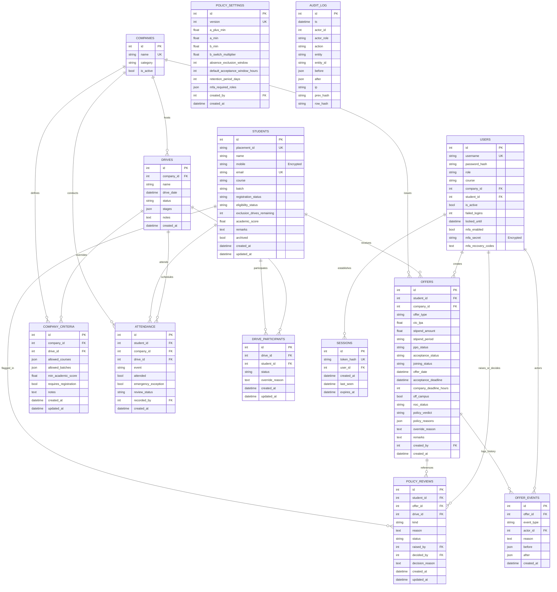

# NFSU Placement System: Database Schema & Entity-Relationship Documentation

## 1. Overview
The database is hosted on SQLite (with WAL mode and foreign key constraints enabled).
All table schemas use non-destructive, additive migrations with idempotent initialization. Sensitive contact data (mobile number) and MFA secrets are encrypted at rest using symmetric Fernet key derivation.

---

## 2. Entity-Relationship Diagram

